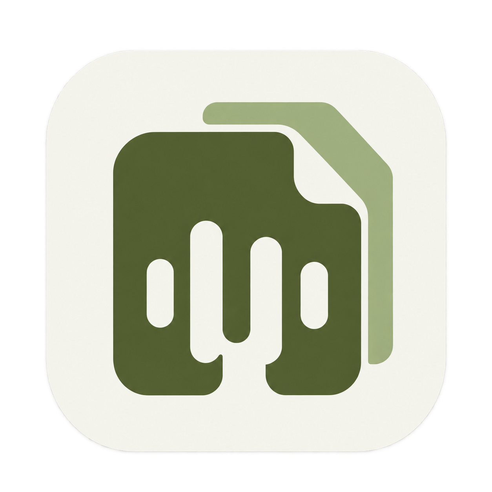
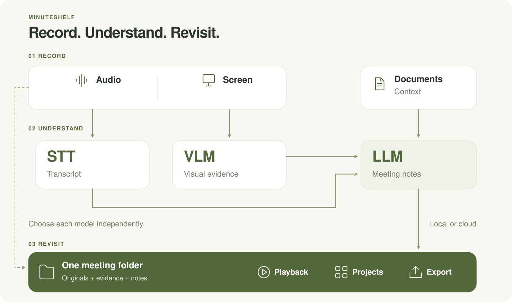
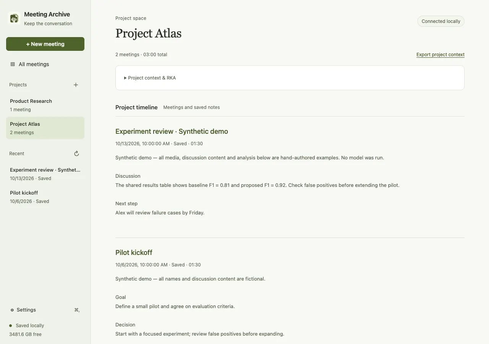
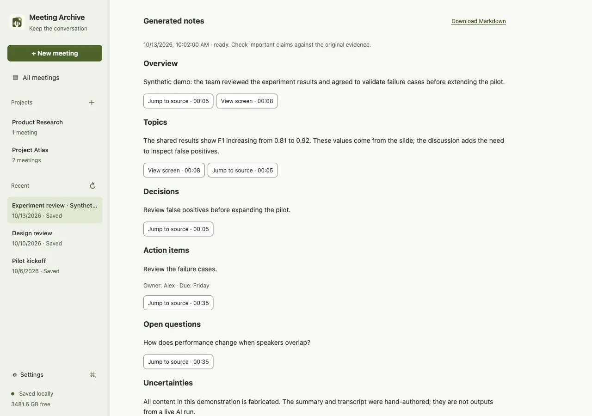
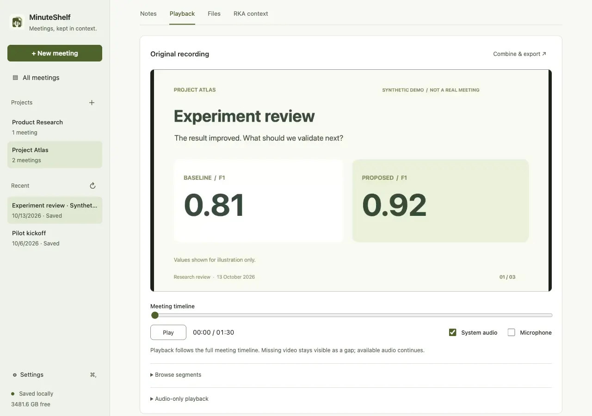
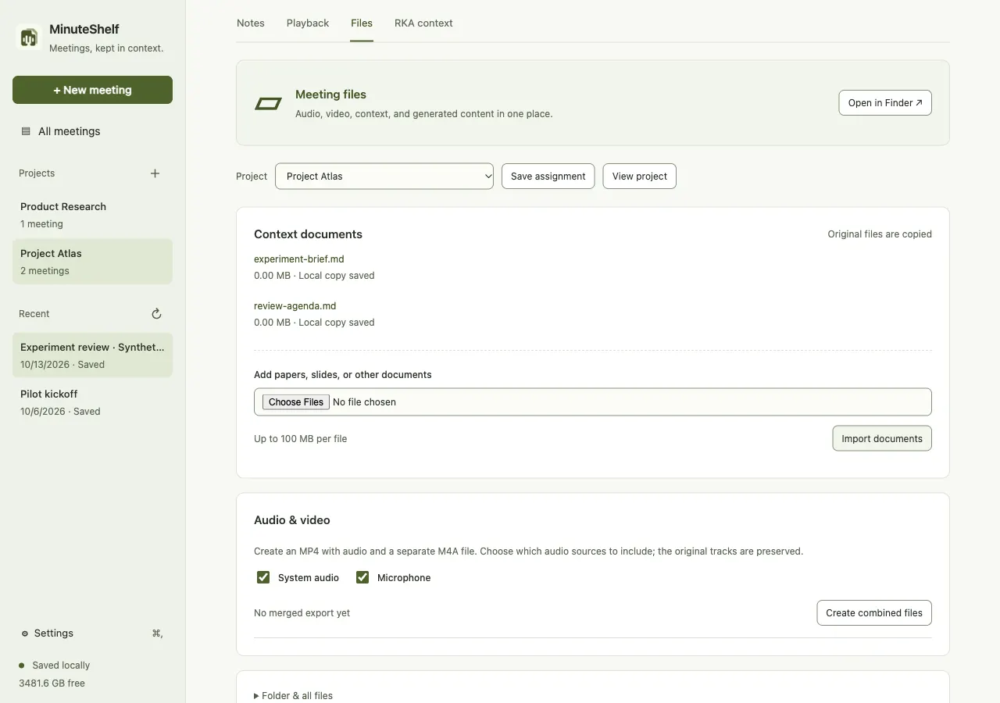

<p align="center">
  
</p>

<h1 align="center">MinuteShelf</h1>

<p align="center"><strong>Meetings, kept in context.</strong></p>
<p align="center">A local-first, bot-free meeting recorder for macOS.<br>Your recordings stay on your Mac. You choose where AI runs.</p>

<p align="center">
  <strong>Local first</strong> · <strong>No meeting bot</strong> · <strong>macOS 15+</strong> · <strong>Apple Silicon</strong> · <strong>MIT</strong>
</p>

<p align="center">
  <a href="https://github.com/infinitywings/minuteshelf/releases/tag/v0.1.12">Download for Mac</a> ·
  <a href="#get-started">Get started</a> ·
  <a href="#a-quick-look">Screenshots</a> ·
  <a href="#choose-your-models">Models</a> ·
  <a href="#capture-support">Capture support</a> ·
  <a href="#roadmap">Roadmap</a> ·
  <a href="#contributing">Contributing</a>
</p>

MinuteShelf keeps the original meeting on your Mac, then helps you revisit it with transcripts, selected screen images, and notes linked to their sources. Group related meetings into projects and keep the background documents beside the conversation.

**No extra participant. No Zoom integration to authorize.** MinuteShelf records the window or display and audio sources you select on your Mac. It does not join the meeting, invite a recording bot, require a Zoom plugin, or ask you to connect your Zoom account. macOS screen/microphone permissions and your meeting's recording policy still apply.

**Privacy by default, model choice by task.** Capture and storage are local. Use local models for local inference, or explicitly allow a remote provider for STT, VLM, or LLM work. Remote analysis sends only the content categories you approve; signing in or saving a model choice does not upload a meeting.

**Status:** 0.1.12 development preview. The app is now **MinuteShelf**. Its legacy bundle identifier and storage path are retained so existing Meeting Archive installations can keep their data and credential scope. Recording and playback have passed bounded real-world tests. Analysis adapters are implemented, with accuracy and real cloud-account validation still in progress.

## Record once. Choose how to understand it.

Capture stays local. After the meeting, choose a **speech model (STT)**, a **vision model (VLM)**, and a **summary model (LLM)** independently. Keep the original files and rerun analysis when your models or context change.

<p align="center">
  
</p>

## A quick look

Interface examples from an isolated synthetic demo of 0.1.10. Version 0.1.12 simplifies playback to one continuous audio track and adds expandable project notes in the sidebar. Transcript and summary examples are fixtures, not results from a real meeting or a model-quality benchmark. Click a screenshot to view it at full size.

<table>
  <tr>
    <td width="50%"><strong>Keep related meetings together</strong><br>Browse a project's meetings and notes in one place.<br><a href="docs/assets/screenshot-project.webp"></a></td>
    <td width="50%"><strong>Review notes with evidence</strong><br>Check summary items against their source references.<br><a href="docs/assets/screenshot-notes.webp"></a></td>
  </tr>
  <tr>
    <td><strong>Return to the recording</strong><br>Inspect the original screen content on the meeting timeline.<br><a href="docs/assets/screenshot-playback.webp"></a></td>
    <td><strong>Keep the supporting material</strong><br>Import background documents and choose media exports.<br><a href="docs/assets/screenshot-files.webp"></a></td>
  </tr>
</table>

## Why MinuteShelf?

- **Keep the meeting participant list unchanged.** Capture on your Mac without adding a bot, connecting your Zoom account, or installing a Zoom integration.
- **Keep the original.** Save the selected window or display, microphone, and system audio locally. Analysis can be retried without overwriting the recording.
- **Record first. Analyze later.** The Swift recorder runs separately from the interface and analysis workers. Heavy AI work happens after the meeting.
- **Follow a note back to its source.** Review transcript and screen references on the meeting timeline. Missing video remains a visible gap.
- **Keep a project together.** Organize meetings, your notes, imported documents, and optional read-only RKA research context.
- **Choose where analysis runs.** Use local speech recognition and choose local or remote providers separately for screen understanding and summaries.
- **Take your files with you.** Each meeting has its own folder. Export a combined MP4 or an audio-only M4A while retaining separate source recordings.

## A meeting, from start to shelf

1. **Choose and preview** a window or display, then select microphone and system audio separately.
2. **Record** while taking notes and adding bookmarks. The menu bar keeps the recording status visible.
3. **Save** the meeting and assign it to a project. Add documents or select RKA context when useful.
4. **Review & analyze** when ready. Choose providers and review which content may leave your Mac.
5. **Revisit** the recording, inspect the evidence behind a note, or export the meeting.

Closing the app window leaves recording running. Quitting asks to stop and save. The recorder's microphone switch is independent of Zoom's mute button. Current system-audio capture includes **all system audio**, not just the meeting application.

## Get started

### Download and install

Download the [Apple Silicon DMG](https://github.com/infinitywings/minuteshelf/releases/download/v0.1.12/MinuteShelf-0.1.12-macOS-arm64.dmg), open it, and drag **MinuteShelf** into **Applications**. A ZIP and SHA-256 checksums are available on the [release page](https://github.com/infinitywings/minuteshelf/releases/tag/v0.1.12). Requires an M-series Mac and macOS 15+; Node.js and Codex are included.

This development preview is **ad-hoc signed, without Apple notarization**. macOS may block the first launch; if you trust the downloaded copy, use **System Settings → Privacy & Security → Open Anyway**. You do not need to disable Gatekeeper.

**Upgrading from Meeting Archive:** stop and save recordings, quit the old app, and move the old **Meeting Archive.app** out of Applications before installing **MinuteShelf.app**. Keep the data folder. Both names use the same bundle identifier, so avoid leaving two launchable copies in Applications. Recheck screen and microphone permissions in the new app; an enabled system toggle alone does not prove access survived an update. See the [installation and permission guide](docs/INSTALL.md).

### Build the macOS app

You need an **Apple Silicon Mac**, **macOS 15 or later**, **Xcode Command Line Tools**, and **Node.js 20+**.

```sh
git clone https://github.com/infinitywings/minuteshelf.git
cd minuteshelf
```

Then build from the repository root:

```sh
npm run vendor:node
npm run vendor:codex
npm run build:app
npm run start:app
```

The vendor commands download and verify pinned runtimes. The build produces `.build/MinuteShelf.app`, including the native helpers, Node backend, and Codex runtime. There are currently no external npm dependencies to install.

To create a local DMG and ZIP:

```sh
npm run package:app
```

Open the resulting DMG in `dist/` and drag **MinuteShelf** to **Applications**. Current builds use ad-hoc signing and are **not Apple-notarized**. After rebuilding or replacing the app, recheck recording access inside the installed app; macOS may require renewed permission.

The app requests screen/system-audio access and, when enabled, microphone access. Accessibility permission is not required by the current recorder. Inform participants before recording and follow the meeting's policy.

### Run the development interface

```sh
npm run build:native
npm start
```

Open the local access link printed by the server. This mode uses `data/` in the repository. The packaged app uses `~/Library/Application Support/Meeting Archive`. `MEETING_DATA` can select another directory; these locations are not automatically merged or migrated.

## Choose your models

Configure **STT**, **VLM**, and **LLM** independently in **Settings → Analysis**. Each task has its own provider and model; API connectors also expose an endpoint and authentication settings. Local and cloud modules can be mixed in one analysis run, subject to your upload choices.

| Task | Implemented options | Setup |
| --- | --- | --- |
| **STT — audio → transcript** | **Qwen3-ASR-1.7B MLX** by default; MiMo-V2.5-ASR MLX, whisper.cpp, a dedicated STT API, or transcript import | Qwen/MiMo require Python 3.11+ and explicit **Install Local STT…** setup. Whisper requires a compatible local runtime and model. API transcription needs an endpoint and any required credentials. |
| **VLM — selected frames → visual evidence** | Codex, Claude Code, Anthropic API, OpenAI-compatible endpoints, local Ollama | Select an image-capable model available to your account/runtime. Remote image processing requires image-upload permission. |
| **LLM — evidence + context → notes** | Codex, Claude Code, Anthropic API, OpenAI-compatible endpoints, local Ollama | Select independently from the VLM. Review permissions for transcripts, notes, and any included background documents. |

For example, use **Qwen locally for STT**, an **image-capable cloud model for VLM**, and a **different local or cloud model for LLM summaries**. These are independently configurable routes, not a requirement to install one fixed model stack. The same compatible provider can also serve both VLM and LLM tasks.

Use **Connect Codex** for the bundled runtime's browser sign-in. Claude Code requires the official native CLI and its provider-specific credential field. API providers have separate key and endpoint settings. Credentials are stored in macOS Keychain by the native app; account access and usage limits depend on the provider.

Model fields accept custom identifiers. Codex and Claude offer refreshable catalogs; a listed model is not proof of account access. Saving preferences or signing in does not start analysis or upload a meeting.

Screen analysis currently samples a bounded set of images from the saved video. It does not send an entire audio/video recording to a coding agent and assume it will transcribe it. Local Qwen/MiMo timestamps currently describe chunks, not word-level alignment. Stable whole-meeting speaker separation and automatic real-name assignment are still on the roadmap.

## Your archive, on disk

Choose **Open in Finder** from a meeting to see its files together:

```text
meetings/<meeting-id>/
├── manifest.json          # Sources, media segments, timestamps, and known gaps
├── user_notes.md
├── raw/                   # Original video, separate audio, and capture events
├── context/
│   ├── documents/         # Imported originals and their provenance
│   └── rka/               # Optional research-context snapshots
├── outputs/<run-id>/      # Transcripts, selected frames, notes, and job state
└── exports/<export-id>/    # Combined MP4 / M4A and export reports
```

Imported documents are copied into the archive. Current analysis reads text files and text-layer PDFs; scanned PDFs and full Office-document parsing need further work. Background context remains distinct from what was actually said or shown in the meeting.

Original recordings are retained by default. Analysis runs and exports have separate outputs. Project grouping and chronological note views are implemented; automatic AI summaries across multiple meetings are not yet available.

## Privacy and control

MinuteShelf records from your Mac; it does not join Zoom as a participant or use a Zoom account integration to record. The capture path requires macOS permissions, with no Zoom OAuth, plugin, or bot invitation to configure.

The archive service binds to `127.0.0.1` with access-token and Host/Origin checks. Recording does not require cloud AI or a MinuteShelf cloud account. Model installation and remote analysis are explicit actions, with content categories and destinations reviewed before analysis starts.

Choosing a remote provider sends the approved content to that provider. Choosing local providers keeps inference local after their dependencies and models are installed. The archive service does not expose an MCP endpoint. Optional RKA access is read-only, and selected RKA content is subject to the same analysis upload choices as other background documents.

The default archive is outside the repository and common cloud-sync folders. Your own backup or synchronization settings still determine where copies may go. These are concrete privacy controls, not a promise that choosing a cloud provider keeps the approved data on your device.

## Capture support

**Zoom receiving a share:** a controlled 10-minute test captured a second participant's shared content in the Zoom desktop window, including changing slides, code, and small highlights. The sender was a separate browser participant on the **same Mac**, with audio disabled. This is not yet a cross-device, audio/video-sync, or long-meeting reliability certification.

**Zoom presenting from this Mac:** the original Zoom meeting window can become unavailable to capture while sharing. Select the **actual document/application window** or explicitly choose **Entire display** instead. A controlled test of the actual shared document window passed. Recording does **not** automatically follow Zoom's chosen sharing source; changing the recorder's source currently requires stopping and selecting again.

MinuteShelf never silently expands a window recording to the whole display. A hidden, suspended, protected, or unavailable source can leave a gap. See [capture support and planned share following](docs/CAPTURE_SUPPORT.md) for the tested boundaries and proposed improvements.

## How it works

The desktop shell and settings use **AppKit**. The meeting interface runs in **WKWebView**. **ScreenCaptureKit** and **AVFoundation** handle native capture and media export, while a bundled **Node.js** backend manages archives and analysis. The recorder writes media directly to disk instead of sending full-resolution frames through the web interface.

The [workflow diagram](docs/assets/minuteshelf-workflow.svg) is an editable SVG. Screenshots show the actual interface with synthetic data; they do not imply that the roadmap items below are complete.

## Roadmap

- [x] Explicit window/display selection, separate audio sources, segmented recording, and timeline playback.
- [x] Projects, notes, bookmarks, document import, read-only RKA context, and media export.
- [x] Provider adapters, manual analysis runs, retryable stages, and evidence references.
- [ ] Confirmed source switching during a recording; investigate Zoom share-source suggestions.
- [ ] Mixed Chinese/English meeting evaluation, whole-meeting diarization, and better alignment.
- [ ] Adaptive visual indexing, OCR/region crops, and better handling of brief or small changes.
- [ ] Email/document connectors, cross-meeting AI project summaries, and task tracking.
- [ ] Cross-device sharing tests, long recordings, audio/video sync, and recovery acceptance.
- [x] Downloadable DMG/ZIP development previews with checksums and an upgrade guide.
- [ ] Developer ID signing and Apple notarization.

An implemented adapter is not a model-quality guarantee. Provider protocol tests use local test services; real account access and representative meeting quality still need separate validation.

## Contributing

Contributions to recording reliability, accessibility, multilingual evaluation, and source-grounded summaries are welcome. Keep changes focused and describe both the behavior changed and the evidence used to test it.

See [Contributing](CONTRIBUTING.md) for the public-file policy and validation, and [Security](SECURITY.md) for private vulnerability reports. Meeting archives, credentials, local reports, and generated builds do not belong in Git.

Start with `native/` for capture and the app shell, `server/` for archives and analysis, `web/` for the meeting interface, and `test/` for backend regressions.

```sh
npm test
```

For native/media changes, choose the relevant scripts in [package.json](package.json), such as `test:native`, `test:export`, or `test:playback-webkit`. Native tests may launch visible helper apps; read the script before running it. Use synthetic recordings and test services rather than private meetings or paid cloud calls in regression tests.

When reporting a capture issue, include app/macOS/meeting-client versions, the selected source type, whether you were presenting or receiving, and a synthetic reproduction. Remove credentials, meeting links, participant details, and private content from logs or screenshots before posting.

## License and acknowledgments

[MIT](LICENSE). This project began as a derivative of [clawd-scribe](https://github.com/clawdbotatg/clawd-scribe), whose copyright and license notices are retained. See [Third-party notices](THIRD_PARTY_NOTICES.md) for runtime and model boundaries. Zoom and the listed AI providers are independent services; this project is not affiliated with them.
